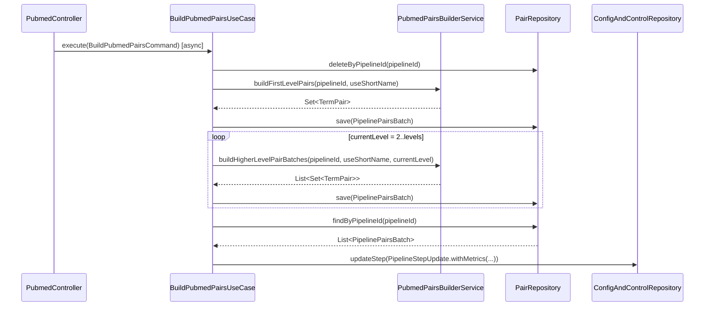

# BuildPubmedPairsUseCase

## 1. Business Problem and Purpose
Before querying PubMed for scientific literature supporting a BioPatternsG pipeline, the system must construct all relevant pairwise combinations of biological terms across the hierarchy levels discovered for that pipeline. This use case retrieves biological objects per level (and their family relationships for higher levels) from `search-biological-objects`, generates deduplicated term pairs (using either principal names/symbols or capped synonym lists), stores them in MongoDB (`pairs`), and notifies `config-and-control` that the `COMBINATIONS` step is complete.

## 2. Contracts
- **Inbound Port:** `com.biopatternsg.domain.ports.in.BuildPubmedPairs`
  - `void execute(BuildPubmedPairsCommand command)`
- **Outbound Ports:**
  - `com.biopatternsg.domain.ports.out.repositories.PairRepository`
    - `void deleteByPipelineId(String pipelineId)`
    - `void save(PipelinePairsBatch batch)`
    - `List<PipelinePairsBatch> findByPipelineId(String pipelineId)`
  - `com.biopatternsg.domain.ports.out.external_repositories.ConfigAndControlRepository`
    - `void updateStep(PipelineStepUpdate update)`
- **Application Services:**
  - `com.biopatternsg.application.services.PubmedPairsBuilderService`
    - `Set<TermPair> buildFirstLevelPairs(String pipelineId, boolean useOnlyPrincipalName)`
    - `List<Set<TermPair>> buildHigherLevelPairBatches(String pipelineId, boolean useOnlyPrincipalName, int level)`
- **Delivery Adapter:** `PubmedController#buildPubmedPairs` (`POST /pubmed/build-pairs`, executed asynchronously via `CompletableFuture.runAsync(...)` with `202 Accepted`; captures `userId` from `SessionUtils` prior to async dispatch and constructs `BuildPubmedPairsCommand`).

## 3. Execution Flow
1. Delete any previously persisted pair documents for `command.pipelineId()` via `pairRepository.deleteByPipelineId(pipelineId)`.
2. Delegate **Level 1** pair construction to `pubmedPairsBuilderService.buildFirstLevelPairs(pipelineId, command.useShortName())` and persist via `pairRepository.save(...)`.
3. For each higher level from `2` up to `command.levels()`, delegate family pair construction to `pubmedPairsBuilderService.buildHigherLevelPairBatches(pipelineId, command.useShortName(), currentLevel)` (which collects pairs thread-safely via `.flatMap(...).collect(Collectors.toSet())` inside `parallelStream()`) and persist each batch via `pairRepository.save(...)`.
4. Query all saved `PipelinePairsBatch` documents for `pipelineId` and sum the total number of generated pairs (`combinationsGenerated`).
5. Notify `config-and-control` via `configAndControlRepository.updateStep(PipelineStepUpdate.withMetrics(pipelineId, PipelineSteps.COMBINATIONS, Status.COMPLETED, command.userId(), metrics))`.

## 4. Sequence Diagram

## 5. Exceptions, Caching, and Failure Scenarios
- **Idempotency / Re-run Behavior:** Existing `pairs` documents for `pipelineId` are cleared at the beginning of execution so re-running the step replaces stale pairs cleanly.
- **Request Validation:** `BuildPairsRequest` is validated with `@Valid` at `PubmedController`.
- **Asynchronous Error Handling:** Because execution runs inside `CompletableFuture.runAsync(...)`, any unexpected exception from `search-biological-objects`, MongoDB, or `config-and-control` is caught and logged in `PubmedController` without altering the already-returned HTTP `202 Accepted` response.
