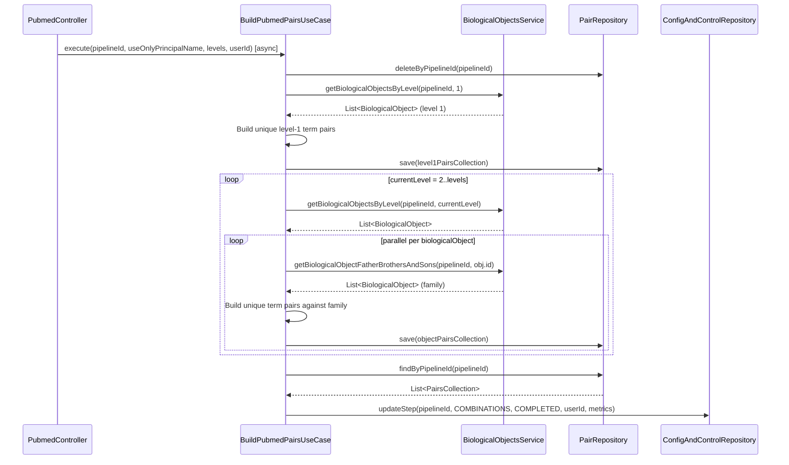

# BuildPubmedPairsUseCase

## 1. Business Problem and Purpose
Before querying PubMed for scientific literature supporting a BioPatternsG pipeline, the system must construct all relevant pairwise combinations of biological terms across the hierarchy levels discovered for that pipeline. This use case retrieves biological objects per level (and their family relationships for higher levels) from `search-biological-objects`, generates deduplicated term pairs (using either principal names/symbols or capped synonym lists), stores them in MongoDB (`pairs`), and notifies `config-and-control` that the `COMBINATIONS` step is complete.

## 2. Contracts
- **Inbound Port:** `com.biopatternsg.domain.ports.in.BuildPubmedPairs`
  - `void execute(String pipelineId, boolean useOnlyPrincipalName, int levels, String userId)`
- **Outbound Ports:**
  - `com.biopatternsg.domain.ports.out.repositories.PairRepository`
    - `void deleteByPipelineId(String pipelineId)`
    - `void save(PairsCollection pairsCollection)`
    - `List<PairsCollection> findByPipelineId(String pipelineId)`
  - `com.biopatternsg.domain.ports.out.external_repositories.ConfigAndControlRepository`
    - `void updateStep(String pipelineId, PipelineSteps step, Status status, String userId, Map<String, String> metrics)`
- **Application Services:**
  - `com.biopatternsg.application.services.BiologicalObjectsService`
    - `List<BiologicalObject> getBiologicalObjectsByLevel(String pipelineId, int level)`
    - `List<BiologicalObject> getBiologicalObjectFatherBrothersAndSons(String pipelineId, String biologicalObjectId)`
- **Configuration Properties:**
  - `pubmed.max-synonyms-per-object` (default `10`): Maximum number of synonyms considered per biological object when `useOnlyPrincipalName` is `false`.
- **Delivery Adapter:** `PubmedController#buildTreeMesh` (`POST /pubmed/build-pairs`, executed asynchronously via `CompletableFuture.runAsync(...)` with `202 Accepted`; captures `userId` from `SessionUtils` prior to async dispatch).

## 3. Execution Flow
1. Delete any previously persisted pair documents for `pipelineId` via `pairRepository.deleteByPipelineId(pipelineId)`.
2. Process **Level 1**:
   1. Fetch all level-1 `BiologicalObject` entries via `biologicalObjectsService.getBiologicalObjectsByLevel(pipelineId, 1)`.
   2. Form all unique unordered pairs of level-1 object IDs.
   3. For each object pair, extract terms (either `name` + `symbol` if `useOnlyPrincipalName` is `true`, or `obj.allTerms(maxSynonyms)` otherwise) and build all unique `PairsGenerator.TermsPair` combinations where `termA` differs case-insensitively from `termB`.
   4. Persist the level-1 `PairsCollection` via `pairRepository.save(...)`.
3. For each higher level from `2` up to `levels`:
   1. Fetch all objects at `currentLevel` via `biologicalObjectsService.getBiologicalObjectsByLevel(pipelineId, currentLevel)`.
   2. Process objects in parallel: for each object, fetch its family (`father`, `brothers`, `sons`) via `biologicalObjectsService.getBiologicalObjectFatherBrothersAndSons(pipelineId, obj.id())`, build unique term pairs against every distinct family member, and persist a `PairsCollection` document.
4. Query all saved `PairsCollection` documents for `pipelineId` and sum the total number of generated pairs (`combinationsGenerated`).
5. Notify `config-and-control` with `PipelineSteps.COMBINATIONS`, `Status.COMPLETED`, `userId`, and the `combinationsGenerated` metric.

## 4. Sequence Diagram

## 5. Exceptions, Caching, and Failure Scenarios
- **Idempotency / Re-run Behavior:** Existing `pairs` documents for `pipelineId` are cleared at the beginning of execution so re-running the step replaces stale pairs cleanly.
- **Request Validation:** `BuildPairsRequest` is validated with `@Valid` at `PubmedController`.
- **Asynchronous Error Handling:** Because execution runs inside `CompletableFuture.runAsync(...)`, any unexpected exception from `search-biological-objects`, MongoDB, or `config-and-control` is caught and logged in `PubmedController` without altering the already-returned HTTP `202 Accepted` response.
