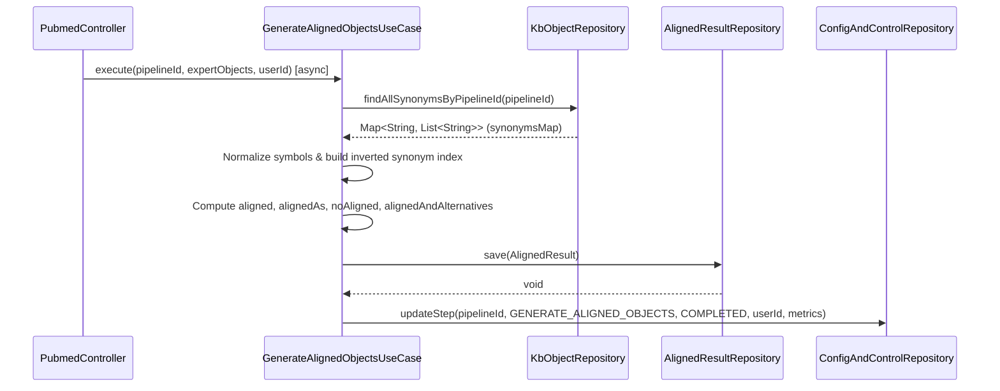

# GenerateAlignedObjectsUseCase

## 1. Business Problem and Purpose
After the Knowledge Base is generated for a pipeline, expert-defined biological objects must be aligned against the objects discovered in scientific literature (`kb_objects`) to determine which symbols match directly, which match indirectly via synonyms (alternatives), and which could not be aligned. This use case builds a case-insensitive inverted synonym index from `kb_objects`, computes the four alignment sets (`aligned`, `alignedAs`, `noAligned`, `alignedAndAlternatives`), persists the result in `alignedResults`, and notifies `config-and-control`.

## 2. Contracts
- **Inbound Port:** `com.biopatternsg.domain.ports.in.GenerateAlignedObjects`
  - `void execute(String pipelineId, List<ExpertObjectConfig> expertObjects, String userId)`
- **Outbound Ports:**
  - `com.biopatternsg.domain.ports.out.repositories.KbObjectRepository`
    - `Map<String, List<String>> findAllSynonymsByPipelineId(String pipelineId)`
  - `com.biopatternsg.domain.ports.out.repositories.AlignedResultRepository`
    - `void save(AlignedResult alignedResult)`
  - `com.biopatternsg.domain.ports.out.external_repositories.ConfigAndControlRepository`
    - `void updateStep(String pipelineId, PipelineSteps step, Status status, String userId)`
    - `void updateStep(String pipelineId, PipelineSteps step, Status status, String userId, Map<String, String> metrics)`
- **Application Services:** None.
- **Delivery Adapter:** `PubmedController#generateAlignedObjects` (`POST /pubmed/generate-aligned-objects`, executed asynchronously via `CompletableFuture.runAsync(...)` with `202 Accepted`; captures `userId` from `SessionUtils`).

## 3. Execution Flow
1. Default a `null` `expertObjects` list to an empty list.
2. Fetch the pipeline's synonym dictionary (`name -> synonyms`) via `kbObjectRepository.findAllSynonymsByPipelineId(pipelineId)`.
3. Normalize expert object symbols (`ExpertObjectConfig::symbol`): filter out null/blank values, uppercase, and deduplicate into `userObjects`.
4. Normalize the synonyms map by uppercasing all keys and non-blank synonym values (merging duplicate uppercased keys cleanly) into `synonymsMapUpper`.
5. Compute `aligned`: expert symbols that directly match a key in `synonymsMapUpper`.
6. Build `invertedSynonyms` (`synonym -> List<mainId>`) from `synonymsMapUpper`.
7. Compute `alignedAsList`: for each expert symbol present in `invertedSynonyms`, emit an `AlignedAs(name, altIds)` whenever `altIds.size() > 1` or the single matched `mainId` differs from `name`.
8. Compute `noAligned`: expert symbols not present in `invertedSynonyms` (or mapping to an empty list).
9. Compute `alignedAndAlternatives`: union of `aligned` and all `alternativeIds` across `alignedAsList`.
10. Persist the `AlignedResult(pipelineId, aligned, noAligned, alignedAsList, alignedAndAlternatives)` via `alignedResultRepository.save(...)`.
11. Notify `config-and-control` with `PipelineSteps.GENERATE_ALIGNED_OBJECTS`, `Status.COMPLETED`, `userId`, and metrics (`alignedObjects`, `notAlignedObjects`).
12. On any unexpected exception, notify `Status.FAILED` to `config-and-control` and rethrow wrapped in `InternalServerError`.

## 4. Sequence Diagram

## 5. Exceptions, Caching, and Failure Scenarios
- **Case-Insensitive Matching:** All expert symbols, KB object keys, and synonyms are uppercased prior to matching; duplicate uppercased keys have their synonym lists merged and deduplicated.
- **Null/Empty Safety:** Null `expertObjects` or null `synonymsMap` safely default to empty collections, producing empty alignment results rather than throwing `NullPointerException`.
- **Failure Reporting:** Any exception triggers `configAndControlRepository.updateStep(..., Status.FAILED, userId)` and throws `com.cifertech.exceptionhandler.exceptions._5xx.InternalServerError`.
- **Log Sanitization:** `pipelineId` is sanitized with `LogSanitizer.sanitize(...)`.
