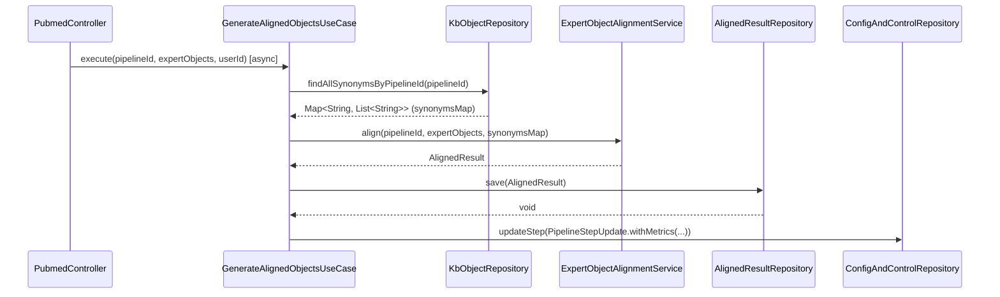

# GenerateAlignedObjectsUseCase

## 1. Business Problem and Purpose
After the Knowledge Base is generated for a pipeline, expert-defined biological objects must be aligned against the objects discovered in scientific literature (`kb_objects`) to determine which symbols match directly, which match indirectly via synonyms (alternatives), and which could not be aligned. This use case builds a case-insensitive inverted synonym index from `kb_objects`, computes the four alignment sets (`aligned`, `alignedAs`, `noAligned`, `alignedAndAlternatives`), persists the result in `alignedResults`, and notifies `config-and-control`.

## 2. Contracts
- **Inbound Port:** `com.biopatternsg.domain.ports.in.GenerateAlignedObjects`
  - `void execute(String pipelineId, List<ExpertObjectConfig> expertObjects, String userId)`
- **Outbound Ports:**
  - `com.biopatternsg.domain.ports.out.repositories.KbObjectRepository`
    - `Map<String, List<String>> findAllSynonymsByPipelineId(String pipelineId)`
  - `com.biopatternsg.domain.ports.out.repositories.AlignedResultRepository`
    - `void save(AlignedResult alignedResult)`
  - `com.biopatternsg.domain.ports.out.external_repositories.ConfigAndControlRepository`
    - `void updateStep(PipelineStepUpdate update)`
- **Application Services:**
  - `com.biopatternsg.application.services.ExpertObjectAlignmentService`
    - `AlignedResult align(String pipelineId, List<ExpertObjectConfig> expertObjects, Map<String, List<String>> synonymsMap)`
- **Delivery Adapter:** `PubmedController#generateAlignedObjects` (`POST /pubmed/generate-aligned-objects`, executed asynchronously via `CompletableFuture.runAsync(...)` with `202 Accepted`; captures `userId` from `SessionUtils`).

## 3. Execution Flow
1. Default a `null` `expertObjects` list to an empty list.
2. Fetch the pipeline's synonym dictionary (`name -> synonyms`) via `kbObjectRepository.findAllSynonymsByPipelineId(pipelineId)`.
3. Delegate symbol normalization, inverted-synonym indexing, and alignment calculation (`aligned`, `alignedAs`, `noAligned`, `alignedAndAlternatives`) to `expertObjectAlignmentService.align(pipelineId, safeExpertObjects, safeSynonyms)`.
4. Persist the returned `AlignedResult` via `alignedResultRepository.save(alignedResult)`.
5. Notify `config-and-control` via `configAndControlRepository.updateStep(PipelineStepUpdate.withMetrics(pipelineId, PipelineSteps.GENERATE_ALIGNED_OBJECTS, Status.COMPLETED, userId, metrics))`.
6. On any unexpected exception, notify `Status.FAILED` via `PipelineStepUpdate.of(...)` and throw `AlignmentException`.

## 4. Sequence Diagram

## 5. Exceptions, Caching, and Failure Scenarios
- **Case-Insensitive Matching:** All expert symbols, KB object keys, and synonyms are uppercased prior to matching; duplicate uppercased keys have their synonym lists merged and deduplicated.
- **Null/Empty Safety:** Null `expertObjects` or null `synonymsMap` safely default to empty collections, producing empty alignment results rather than throwing `NullPointerException`.
- **Failure Reporting:** Any exception triggers `configAndControlRepository.updateStep(..., Status.FAILED, userId)` and throws `com.cifertech.exceptionhandler.exceptions._5xx.InternalServerError`.
- **Log Sanitization:** `pipelineId` is sanitized with `LogSanitizer.sanitize(...)`.
