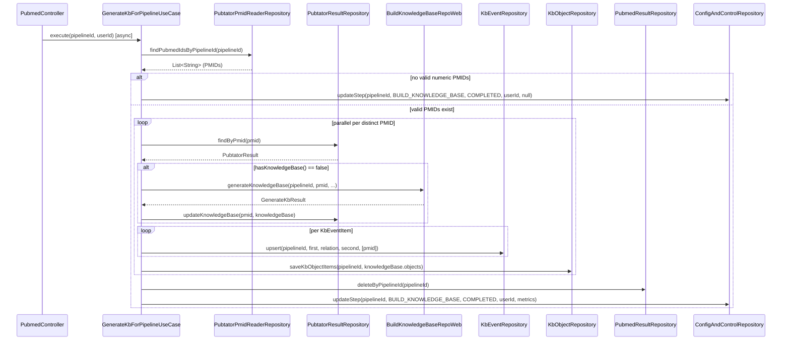

# GenerateKbForPipelineUseCase

## 1. Business Problem and Purpose
To construct the biological Knowledge Base (KB) for a pipeline, annotated PubTator3 documents for all pipeline PMIDs must be transformed into normalized biological events (`kb_events`) and biological objects with synonyms and biotypes (`kb_objects`). This use case orchestrates parallel processing across all pipeline PMIDs, reuses previously computed KB fragments cached on `pubtator_results` whenever available (calling `build-knowledge-base` only on cache misses), upserts deduplicated events and objects into MongoDB, cleans up temporary `pubmed_results`, and reports `BUILD_KNOWLEDGE_BASE` status and metrics to `config-and-control`.

## 2. Contracts
- **Inbound Port:** `com.biopatternsg.domain.ports.in.GenerateKbForPipeline`
  - `void execute(String pipelineId, String userId)`
- **Outbound Ports:**
  - `com.biopatternsg.domain.ports.out.repositories.PubtatorPmidReaderRepository`
    - `List<String> findPubmedIdsByPipelineId(String pipelineId)`
  - `com.biopatternsg.domain.ports.out.repositories.PubtatorResultRepository`
    - `PubtatorResult findByPmid(String pmid)`
    - `void updateKnowledgeBase(String pmid, PubtatorResult.KnowledgeBase knowledgeBase)`
  - `com.biopatternsg.domain.ports.out.external_repositories.BuildKnowledgeBaseRepoWeb`
    - `GenerateKbResult generateKnowledgeBase(String pipelineId, PubtatorResult pubtatorResult)`
  - `com.biopatternsg.domain.ports.out.repositories.KbEventRepository`
    - `void upsert(KbEvent event)`
  - `com.biopatternsg.domain.ports.out.repositories.KbObjectRepository`
    - `void saveKbObjectItems(String pipelineId, List<PubtatorResult.KbObjectItem> objects)`
  - `com.biopatternsg.domain.ports.out.repositories.PubmedResultRepository`
    - `void deleteByPipelineId(String pipelineId)`
  - `com.biopatternsg.domain.ports.out.external_repositories.ConfigAndControlRepository`
    - `void updateStep(PipelineStepUpdate update)`
- **Application Services:** None.
- **Delivery Adapter:** `PubmedController#generateKb` (`POST /pubmed/generate-kb`, executed asynchronously via `CompletableFuture.runAsync(...)` with `202 Accepted`; captures `userId` from `SessionUtils`).

## 3. Execution Flow
1. Retrieve all PMIDs for `pipelineId` via `pubtatorPmidReaderRepository.findPubmedIdsByPipelineId(pipelineId)`, filtering for numeric strings (`\\d+`) and deduplicating.
2. If no valid PMIDs exist, log a warning, report `PipelineSteps.BUILD_KNOWLEDGE_BASE` as `Status.COMPLETED` (with `null` metrics) to `config-and-control`, and return early.
3. Process all distinct PMIDs in parallel (`allPmids.parallelStream()`), tracking `successCount`, `notFoundCount`, and `errorCount` via `AtomicInteger`:
   1. Fetch the `PubtatorResult` by `pmid` via `pubtatorResultRepository.findByPmid(pmid)`. If `null`, increment `notFoundCount` and continue.
   2. Resolve `PubtatorResult.KnowledgeBase`:
      - If `pubtatorResult.hasKnowledgeBase()` is `true`, reuse the cached `knowledgeBase` without calling `build-knowledge-base`.
      - Otherwise, call `buildKnowledgeBaseRepoWeb.generateKnowledgeBase(...)`, build `PubtatorResult.KnowledgeBase.from(events, synonyms, biotypes)`, and cache it on the document via `pubtatorResultRepository.updateKnowledgeBase(pmid, knowledgeBase)`.
   3. Upsert every event into `kb_events` via `kbEventRepository.upsert(pipelineId, first, relation, second, List.of(pmid))`.
   4. Persist KB objects (synonyms + biotypes) into `kb_objects` via `kbObjectRepository.saveKbObjectItems(pipelineId, knowledgeBase.objects())`.
   5. Increment `successCount`.
4. Clean up processed `pubmed_results` records for `pipelineId` via `pubmedResultRepository.deleteByPipelineId(pipelineId)`.
5. Notify `config-and-control` with `PipelineSteps.BUILD_KNOWLEDGE_BASE`, `Status.COMPLETED`, `userId`, and metrics (`kbEventsGenerated`, `pmidsProcessed`, `pmidsWithErrors`).
6. On any fatal uncaught exception at the outer level, log the sanitized error and report `Status.FAILED` to `config-and-control`.

## 4. Sequence Diagram

## 5. Exceptions, Caching, and Failure Scenarios
- **KB Caching (`pubtator_results`):** Once a PMID's KB is generated by `build-knowledge-base`, it is stored inside the `pubtator_results` document so subsequent pipelines referencing the same PMID skip the remote HTTP call.
- **Per-PMID & Per-Event Isolation:** Exceptions for an individual PMID increment `errorCount` without aborting the rest of the pipeline; individual `kbEventRepository.upsert(...)` errors are logged without dropping remaining events.
- **Fatal Failure Reporting:** Outer exceptions transition `BUILD_KNOWLEDGE_BASE` to `Status.FAILED` in `config-and-control`.
- **Log Sanitization:** `pipelineId` is sanitized with `LogSanitizer.sanitize(...)` in log statements.
