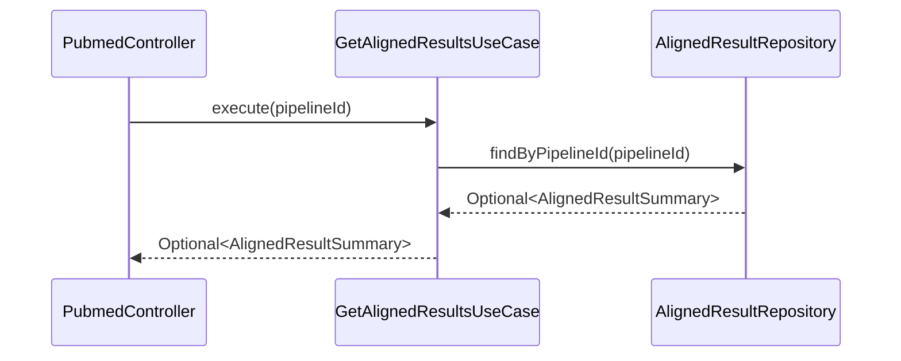

# GetAlignedResultsUseCase

## 1. Business Problem and Purpose
After `GenerateAlignedObjectsUseCase` completes expert object alignment for a pipeline, clients (such as the BioPatternsG UI and inference services) need to retrieve the resulting alignment summary (`aligned`, `noAligned`, `alignedAs`, `alignedAndAlternatives`). This use case fetches the stored `AlignedResultSummary` for a given `pipelineId`.

## 2. Contracts
- **Inbound Port:** `com.biopatternsg.domain.ports.in.GetAlignedResults`
  - `Optional<AlignedResultSummary> execute(String pipelineId)`
- **Outbound Ports:**
  - `com.biopatternsg.domain.ports.out.repositories.AlignedResultRepository`
    - `Optional<AlignedResultSummary> findByPipelineId(String pipelineId)`
- **Application Services:** None.
- **Delivery Adapter:** `PubmedController#getAlignedResults` (`GET /pubmed/aligned-results/{pipelineId}`, returns `200 OK` when present or `404 Not Found` when absent).

## 3. Execution Flow
1. Log the request with `LogSanitizer.sanitize(pipelineId)`.
2. Query `alignedResultRepository.findByPipelineId(pipelineId)`.
3. Return the `Optional<AlignedResultSummary>` to `PubmedController`.

## 4. Sequence Diagram

## 5. Exceptions, Caching, and Failure Scenarios
- **Not Found Handling:** When `Optional.empty()` is returned, `PubmedController` responds with HTTP `404 Not Found`.
- **Read-Only Query:** Performs no state mutations in MongoDB.
- **Log Sanitization:** `pipelineId` is sanitized with `LogSanitizer.sanitize(...)`.
