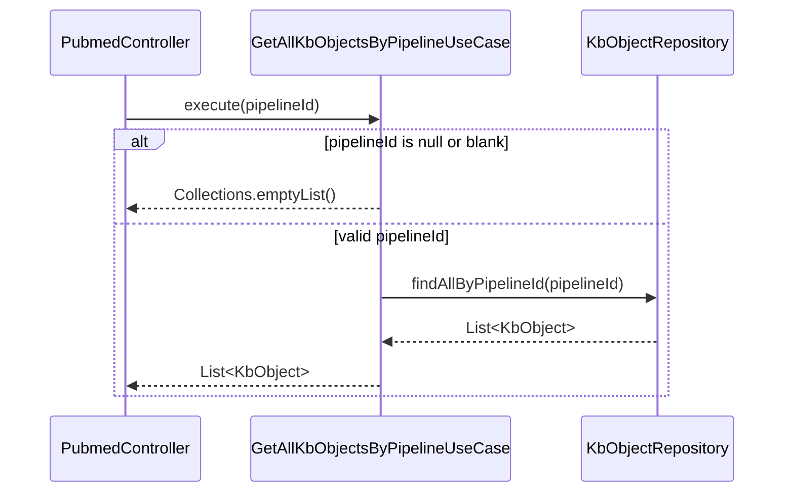

# GetAllKbObjectsByPipelineUseCase

## 1. Business Problem and Purpose
Downstream analysis and classification workflows (such as role assignment, ontology enrichment, or export jobs) occasionally require the complete, unpaginated list of all Knowledge Base objects discovered for a pipeline. This use case fetches every `KbObject` belonging to a given `pipelineId`.

## 2. Contracts
- **Inbound Port:** `com.biopatternsg.domain.ports.in.GetAllKbObjectsByPipeline`
  - `List<KbObject> execute(String pipelineId)`
- **Outbound Ports:**
  - `com.biopatternsg.domain.ports.out.repositories.KbObjectRepository`
    - `List<KbObject> findAllByPipelineId(String pipelineId)`
- **Application Services:** None.
- **Delivery Adapter:** `PubmedController#getAllKbObjects` (`GET /pubmed/kb-objects/{pipelineId}/all`, returns `200 OK`).

## 3. Execution Flow
1. Log the request with `LogSanitizer.sanitize(pipelineId)`.
2. Guard against invalid input: if `pipelineId` is `null` or blank, return `Collections.emptyList()`.
3. Query `kbObjectRepository.findAllByPipelineId(pipelineId)` and return the full `List<KbObject>`.

## 4. Sequence Diagram

## 5. Exceptions, Caching, and Failure Scenarios
- **Input Guard:** Null or blank `pipelineId` short-circuits cleanly and returns an empty list without hitting MongoDB.
- **Empty Pipeline:** If no `kb_objects` exist for `pipelineId`, an empty list is returned with HTTP `200 OK`.
- **Log Sanitization:** `pipelineId` is sanitized with `LogSanitizer.sanitize(...)`.
