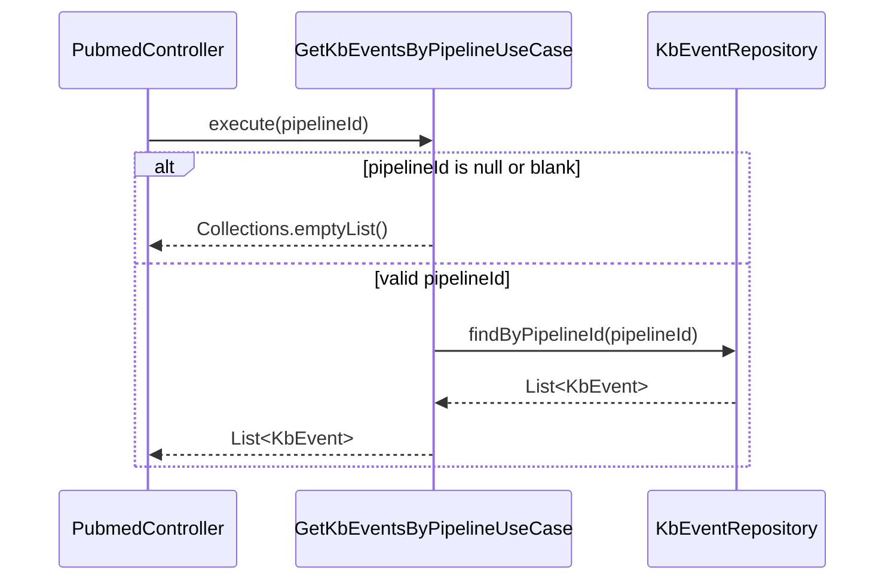

# GetKbEventsByPipelineUseCase

## 1. Business Problem and Purpose
Downstream inference engines and visualization screens require access to the full set of biological relations (`kb_events`) extracted for a pipeline. This use case retrieves all deduplicated `KbEvent` records belonging to a specified `pipelineId`.

## 2. Contracts
- **Inbound Port:** `com.biopatternsg.domain.ports.in.GetKbEventsByPipeline`
  - `List<KbEvent> execute(String pipelineId)`
- **Outbound Ports:**
  - `com.biopatternsg.domain.ports.out.repositories.KbEventRepository`
    - `List<KbEvent> findByPipelineId(String pipelineId)`
- **Application Services:** None.
- **Delivery Adapter:** `PubmedController#getKbEventsByPipeline` (`GET /pubmed/kb-events/{pipelineId}`, returns `200 OK`, or `400 Bad Request` when `pipelineId` is blank).

## 3. Execution Flow
1. Log the query with `LogSanitizer.sanitize(pipelineId)`.
2. Guard against invalid input: if `pipelineId` is `null` or blank, return `Collections.emptyList()`.
3. Query `kbEventRepository.findByPipelineId(pipelineId)` and return all matching `KbEvent` records.

## 4. Sequence Diagram

## 5. Exceptions, Caching, and Failure Scenarios
- **Blank Parameter Guard:** `PubmedController` returns HTTP `400 Bad Request` for blank `pipelineId`, and the use case defensively returns `Collections.emptyList()`.
- **No Matches:** Returns an empty list with HTTP `200 OK` when the pipeline has no persisted `kb_events`.
- **Log Sanitization:** `pipelineId` is sanitized with `LogSanitizer.sanitize(...)`.
