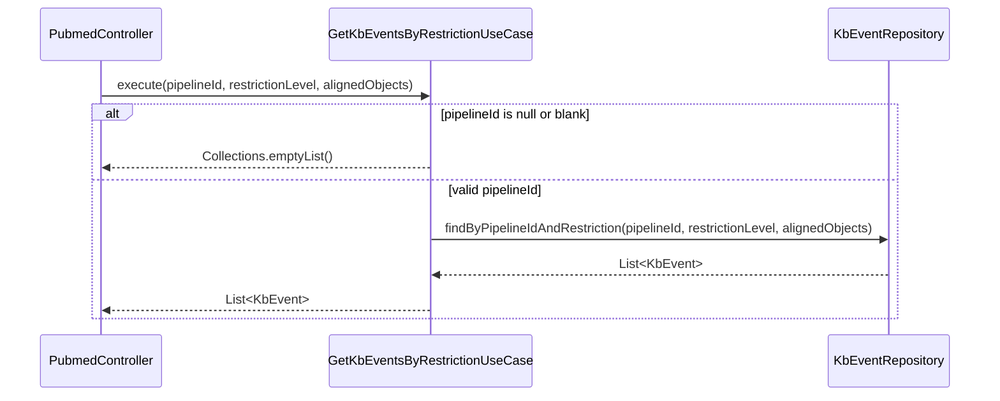

# GetKbEventsByRestrictionUseCase

## 1. Business Problem and Purpose
When constructing biological networks or executing inference queries, researchers may restrict the Knowledge Base events (`kb_events`) to those connected to a specific set of aligned biological objects according to a configurable restriction level (for example, requiring both participants or at least one participant to belong to `alignedObjects`, or returning unrestricted events). This use case retrieves the filtered list of `KbEvent` records for a pipeline based on `restrictionLevel` and `alignedObjects`.

## 2. Contracts
- **Inbound Port:** `com.biopatternsg.domain.ports.in.GetKbEventsByRestriction`
  - `List<KbEvent> execute(String pipelineId, String restrictionLevel, List<String> alignedObjects)`
- **Outbound Ports:**
  - `com.biopatternsg.domain.ports.out.repositories.KbEventRepository`
    - `List<KbEvent> findByPipelineIdAndRestriction(String pipelineId, String restrictionLevel, List<String> alignedObjects)`
- **Application Services:** None.
- **Delivery Adapter:** `PubmedController#getKbEventsByRestriction` (`POST /pubmed/kb-events/{pipelineId}/by-restriction`, accepts `KbEventsByRestrictionRequest(restrictionLevel, alignedObjects)`, returns `200 OK`, or `400 Bad Request` when `pipelineId` is blank).

## 3. Execution Flow
1. Log the request with sanitized `pipelineId`, sanitized `restrictionLevel`, and the count of `alignedObjects`.
2. Guard against invalid input: if `pipelineId` is `null` or blank, return `Collections.emptyList()`.
3. Delegate filtering to `kbEventRepository.findByPipelineIdAndRestriction(pipelineId, restrictionLevel, alignedObjects)` and return the resulting `List<KbEvent>`.

## 4. Sequence Diagram

## 5. Exceptions, Caching, and Failure Scenarios
- **Blank Parameter Guard:** Both `PubmedController` (`400 Bad Request`) and the use case (`Collections.emptyList()`) guard against null or blank `pipelineId`.
- **Optional Request Body Fields:** If `KbEventsByRestrictionRequest` or its fields (`restrictionLevel`, `alignedObjects`) are `null`, the controller passes `null` safely to the use case and repository adapter.
- **Log Sanitization:** `pipelineId` and `restrictionLevel` are sanitized with `LogSanitizer.sanitize(...)`.
