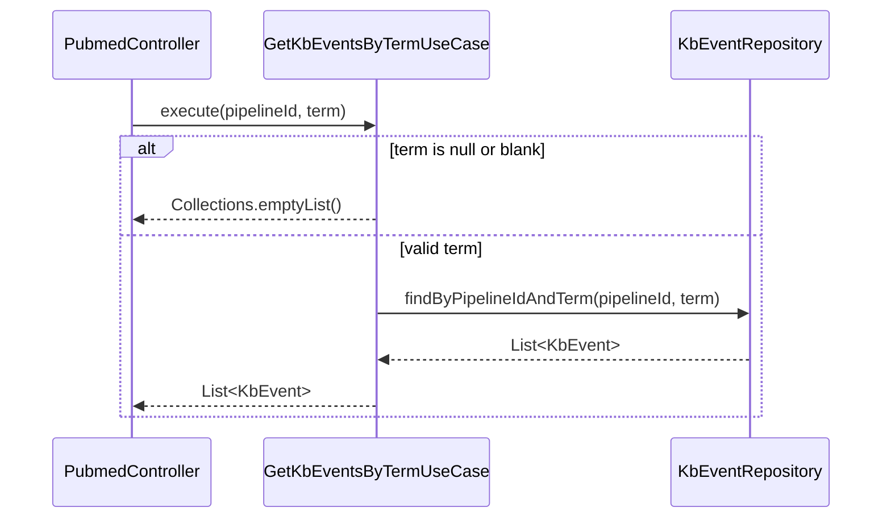

# GetKbEventsByTermUseCase

## 1. Business Problem and Purpose
Users and downstream analysis modules often need to inspect all extracted biological interactions (`kb_events`) within a pipeline that involve a specific biological term (as either the `first` or `second` participant). This use case retrieves all matching `KbEvent` records for a given `pipelineId` and `term`.

## 2. Contracts
- **Inbound Port:** `com.biopatternsg.domain.ports.in.GetKbEventsByTerm`
  - `List<KbEvent> execute(String pipelineId, String term)`
- **Outbound Ports:**
  - `com.biopatternsg.domain.ports.out.repositories.KbEventRepository`
    - `List<KbEvent> findByPipelineIdAndTerm(String pipelineId, String term)`
- **Application Services:** None.
- **Delivery Adapter:** `PubmedController#getKbEventsByTerm` (`GET /pubmed/kb-events/{pipelineId}/by-term/{term}`, returns `200 OK`, or `400 Bad Request` when `term` is blank).

## 3. Execution Flow
1. Log the query with `pipelineId` and `term` sanitized via `LogSanitizer.sanitize(...)`.
2. Guard against invalid input: if `term` is `null` or blank, return `Collections.emptyList()`.
3. Delegate to `kbEventRepository.findByPipelineIdAndTerm(pipelineId, term)` and return the matching `List<KbEvent>`.

## 4. Sequence Diagram

## 5. Exceptions, Caching, and Failure Scenarios
- **Blank Parameter Guard:** Both `PubmedController` (`400 Bad Request`) and the use case (`Collections.emptyList()`) guard against null or blank `term` values.
- **No Matches:** Returns an empty list with HTTP `200 OK` if no events reference `term` in `pipelineId`.
- **Log Sanitization:** `pipelineId` and `term` are sanitized via `LogSanitizer.sanitize(...)`.
