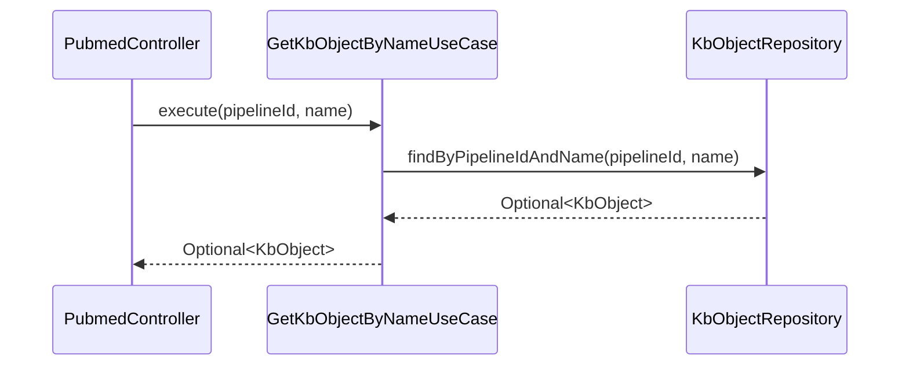

# GetKbObjectByNameUseCase

## 1. Business Problem and Purpose
Consumers such as the BioPatternsG UI and downstream inference services frequently need to inspect the full metadata (synonyms, biotypes, and assigned roles) of a single biological object within a pipeline's Knowledge Base. This use case looks up an individual `KbObject` by its `pipelineId` and `name`.

## 2. Contracts
- **Inbound Port:** `com.biopatternsg.domain.ports.in.GetKbObjectByName`
  - `Optional<KbObject> execute(String pipelineId, String name)`
- **Outbound Ports:**
  - `com.biopatternsg.domain.ports.out.repositories.KbObjectRepository`
    - `Optional<KbObject> findByPipelineIdAndName(String pipelineId, String name)`
- **Application Services:** None.
- **Delivery Adapter:**
  - `PubmedController#getKbObjectByName` (`GET /pubmed/kb-objects/{pipelineId}/by-name/{name}`, returns `200 OK` when found, `404 Not Found` when absent, `400 Bad Request` when `name` is blank).
  - `PubmedController#getSynonymsByName` (`GET /pubmed/synonyms/{pipelineId}/by-name/{name}`, legacy alias delegating to `getKbObjectByName`).

## 3. Execution Flow
1. Log the lookup request with `pipelineId` and `name` sanitized via `LogSanitizer.sanitize(...)`.
2. Query `kbObjectRepository.findByPipelineIdAndName(pipelineId, name)`.
3. Return the resulting `Optional<KbObject>` to the controller.

## 4. Sequence Diagram

## 5. Exceptions, Caching, and Failure Scenarios
- **Not Found Handling:** When `Optional.empty()` is returned, `PubmedController` responds with HTTP `404 Not Found`.
- **Blank Parameter Guard:** `PubmedController` returns HTTP `400 Bad Request` if the `name` path parameter is null or blank.
- **Log Injection Prevention:** Both `pipelineId` and `name` are sanitized with `LogSanitizer.sanitize(...)` before logging.
