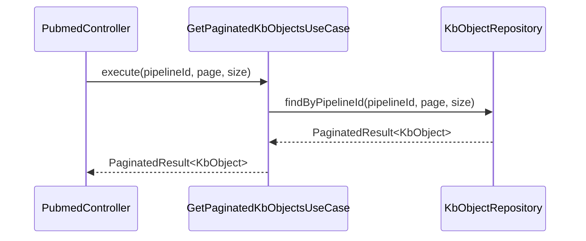

# GetPaginatedKbObjectsUseCase

## 1. Business Problem and Purpose
Knowledge Bases for large biological pipelines can contain thousands of extracted objects (`kb_objects`), making full-list transfers expensive for UI tables and synonym browsers. This use case retrieves a paginated slice of `KbObject` records for a given pipeline so clients can browse objects, synonyms, biotypes, and roles incrementally.

## 2. Contracts
- **Inbound Port:** `com.biopatternsg.domain.ports.in.GetPaginatedKbObjects`
  - `PaginatedResult<KbObject> execute(String pipelineId, int page, int size)`
- **Outbound Ports:**
  - `com.biopatternsg.domain.ports.out.repositories.KbObjectRepository`
    - `PaginatedResult<KbObject> findByPipelineId(String pipelineId, int page, int size)`
- **Application Services:** None.
- **Delivery Adapter:**
  - `PubmedController#getKbObjects` (`GET /pubmed/kb-objects/{pipelineId}?page=0&size=50`, returns `200 OK`).
  - `PubmedController#getSynonyms` (`GET /pubmed/synonyms/{pipelineId}?page=0&size=50`, legacy alias delegating to `getKbObjects`).

## 3. Execution Flow
1. Receive `pipelineId`, `page`, and `size` from the inbound adapter (`PubmedController` defaults `page=0` and `size=50`).
2. Delegate directly to `kbObjectRepository.findByPipelineId(pipelineId, page, size)`.
3. Return the `PaginatedResult<KbObject>` containing the current page items and pagination metadata.

## 4. Sequence Diagram

## 5. Exceptions, Caching, and Failure Scenarios
- **Empty Results:** If no `kb_objects` exist for `pipelineId` or the requested page is out of range, an empty `PaginatedResult<KbObject>` is returned with HTTP `200 OK`.
- **Read-Only Query:** This operation performs no writes and has no side effects.
- **Backward Compatibility:** Accessible under both `/pubmed/kb-objects/{pipelineId}` and `/pubmed/synonyms/{pipelineId}`.
