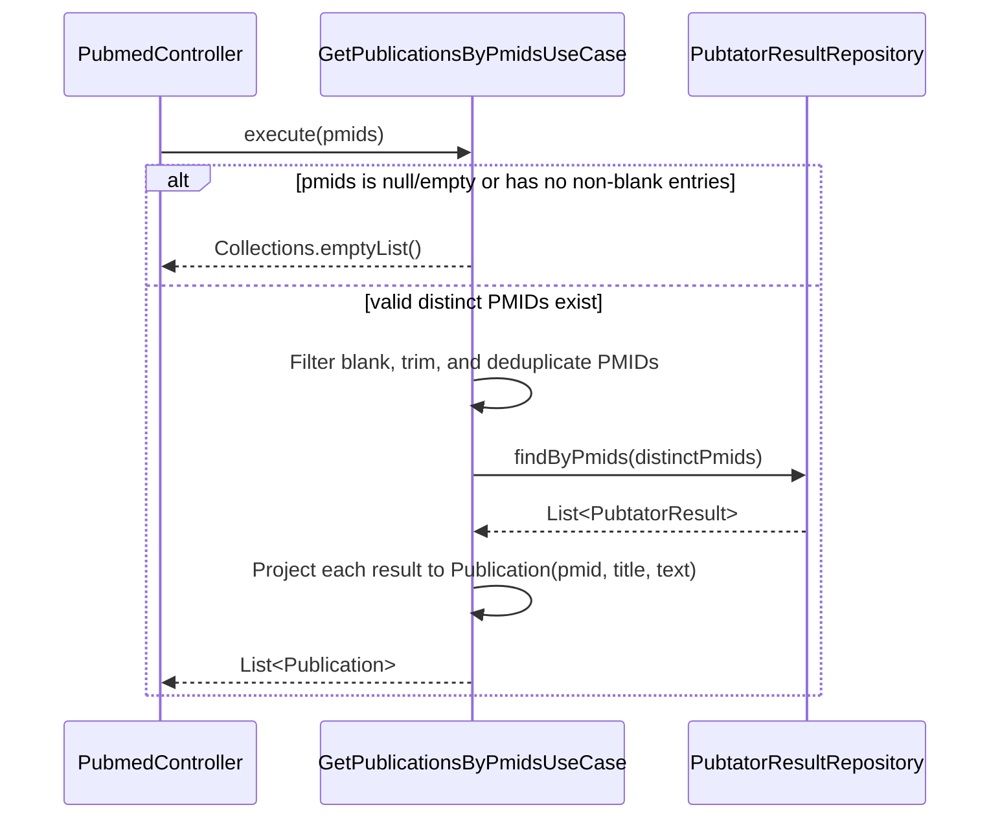

# GetPublicationsByPmidsUseCase

## 1. Business Problem and Purpose
When exploring Knowledge Base events or inferred biological patterns, users need to inspect the scientific literature (title and abstract text) supporting the evidence PMIDs attached to each event. This use case accepts a list of PMIDs, cleans and deduplicates them, queries cached documents from `pubtator_results`, and projects them into lightweight `Publication(pmid, title, text)` domain records.

## 2. Contracts
- **Inbound Port:** `com.biopatternsg.domain.ports.in.GetPublicationsByPmids`
  - `List<Publication> execute(List<String> pmids)`
- **Outbound Ports:**
  - `com.biopatternsg.domain.ports.out.repositories.PubtatorResultRepository`
    - `List<PubtatorResult> findByPmids(List<String> pmids)`
- **Application Services:** None.
- **Delivery Adapter:** `PubmedController#getPublicationsByPmids` (`POST /pubmed/publications/by-pmids`, validates `GetPublicationsByPmidsRequest` via `@Valid`, returns `200 OK`).

## 3. Execution Flow
1. Log the count of requested PMIDs.
2. If `pmids` is `null` or empty, return `Collections.emptyList()`.
3. Filter out `null` or blank entries, trim whitespace, and deduplicate into `distinctPmids`.
4. If `distinctPmids` is empty, return `Collections.emptyList()`.
5. Query `pubtatorResultRepository.findByPmids(distinctPmids)` to retrieve matching `PubtatorResult` documents from MongoDB (`pubtator_results`).
6. Map each `PubtatorResult` into a `Publication(pmid, title, text)` record and return the list.

## 4. Sequence Diagram

## 5. Exceptions, Caching, and Failure Scenarios
- **Input Sanitization & Deduplication:** Blank entries are discarded and duplicate PMIDs are deduplicated prior to querying MongoDB, avoiding redundant lookups.
- **Partial Matches:** Only PMIDs present in `pubtator_results` are returned; missing PMIDs are silently omitted without failing the request.
- **Request Validation:** `GetPublicationsByPmidsRequest` is validated with `@Valid` at `PubmedController`.
