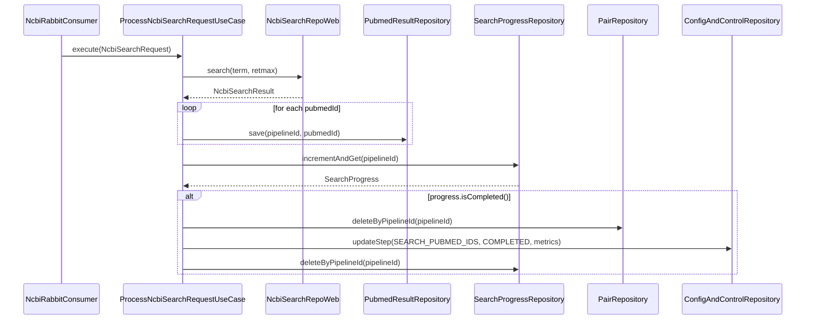

# ProcessNcbiSearchRequestUseCase

## 1. Business Problem and Purpose
Each term pair enqueued by `SearchPubmedByPairsUseCase` must be queried against the NCBI PubMed ESearch API, its discovered PMIDs stored in `pubmed_results`, and atomic pipeline progress tracked in `search_progress`. Once all terms in the pipeline complete, the intermediate `pairs` and `search_progress` documents are cleaned up and `PipelineSteps.SEARCH_PUBMED_IDS` is reported as `COMPLETED` to `config-and-control`.

## 2. Contracts
- **Inbound Port:** `com.biopatternsg.domain.ports.in.ProcessNcbiSearchRequest`
  - `void execute(NcbiSearchRequest request)`
- **Outbound Ports:**
  - `com.biopatternsg.domain.ports.out.external_repositories.NcbiSearchRepoWeb`
  - `com.biopatternsg.domain.ports.out.repositories.PubmedResultRepository`
  - `com.biopatternsg.domain.ports.out.repositories.PairRepository`
  - `com.biopatternsg.domain.ports.out.repositories.SearchProgressRepository`
  - `com.biopatternsg.domain.ports.out.repositories.PubtatorPmidReaderRepository`
  - `com.biopatternsg.domain.ports.out.external_repositories.ConfigAndControlRepository`
- **Application Services:** None.
- **Delivery Adapter:** `NcbiRabbitConsumer` (`@Incoming("ncbi-in")`, `@Blocking(ordered = false)`).

## 3. Execution Flow
1. Validate that `request` and `request.pipelineId()` are non-blank.
2. Execute `ncbiSearchRepoWeb.search(request.term(), request.retmax())` and persist each returned PMID via `pubmedResultRepository.save(request.pipelineId(), pubmedId)`.
3. In a `finally` block, atomically increment progress via `searchProgressRepository.incrementAndGet(request.pipelineId())`.
4. When `progress.isCompleted()` is `true`:
   - Delete processed pairs via `pairRepository.deleteByPipelineId(request.pipelineId())`.
   - Count unique numeric PMIDs from `pubtatorPmidReaderRepository.findPubmedIdsByPipelineId(request.pipelineId())`.
   - Notify `configAndControlRepository.updateStep(request.pipelineId(), PipelineSteps.SEARCH_PUBMED_IDS, Status.COMPLETED, request.userId(), metrics)`.
   - Clean up progress via `searchProgressRepository.deleteByPipelineId(request.pipelineId())`.

## 4. Sequence Diagram

## 5. Exceptions, Caching, and Failure Scenarios
- **Progress Guarantee:** Even if the NCBI HTTP call throws an exception, the `finally` block still increments `search_progress` so the pipeline never stalls waiting for a failed term.
- **Log Sanitization:** `request.term()`, `result.term()`, and `request.pipelineId()` are sanitized with `LogSanitizer.sanitize(...)` before logging.
