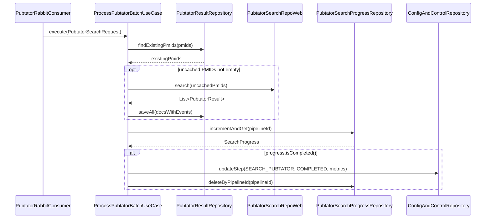

# ProcessPubtatorBatchUseCase

## 1. Business Problem and Purpose
Batches of PMIDs enqueued by `SearchPubtatorByPmidsUseCase` must be enriched with biological entities and events from PubTator3 while skipping PMIDs already cached in `pubtator_results`. Only publications containing biological events (`hasEvents()`) are persisted, and once all batches for a pipeline finish, `PipelineSteps.SEARCH_PUBTATOR` is reported as `COMPLETED` with annotation metrics.

## 2. Contracts
- **Inbound Port:** `com.biopatternsg.domain.ports.in.ProcessPubtatorBatch`
  - `void execute(PubtatorSearchRequest request)`
- **Outbound Ports:**
  - `com.biopatternsg.domain.ports.out.external_repositories.PubtatorSearchRepoWeb`
  - `com.biopatternsg.domain.ports.out.repositories.PubtatorResultRepository`
  - `com.biopatternsg.domain.ports.out.repositories.PubtatorSearchProgressRepository`
  - `com.biopatternsg.domain.ports.out.repositories.PubtatorPmidReaderRepository`
  - `com.biopatternsg.domain.ports.out.external_repositories.ConfigAndControlRepository`
- **Application Services:** None.
- **Delivery Adapter:** `PubtatorRabbitConsumer` (`@Incoming("pubtator-in")`, `@Blocking(ordered = false)`).

## 3. Execution Flow
1. Validate that `request` and `request.pipelineId()` are non-blank.
2. Filter out already-cached PMIDs via `pubtatorResultRepository.findExistingPmids(pmids)`.
3. If uncached PMIDs remain, call `pubtatorSearchRepoWeb.search(pmidsToFetch)` (returning parsed `List<PubtatorResult>`), filter by `PubtatorResult::hasEvents`, and persist via `pubtatorResultRepository.saveAll(...)`.
4. In a `finally` block, atomically increment progress via `pubtatorSearchProgressRepository.incrementAndGet(request.pipelineId())`.
5. When `progress.isCompleted()` is `true`, compute `pmidsAnnotated` and `pmidsNotFound` metrics, notify `configAndControlRepository.updateStep(request.pipelineId(), PipelineSteps.SEARCH_PUBTATOR, Status.COMPLETED, request.userId(), metrics)`, and delete `pubtator_search_progress` for the pipeline.

## 4. Sequence Diagram

## 5. Exceptions, Caching, and Failure Scenarios
- **Cache-First Optimization:** Already-indexed PMIDs in `pubtator_results` are skipped before calling PubTator3.
- **Progress Guarantee:** The `finally` block ensures batch progress is always incremented even if a remote PubTator3 call fails.
