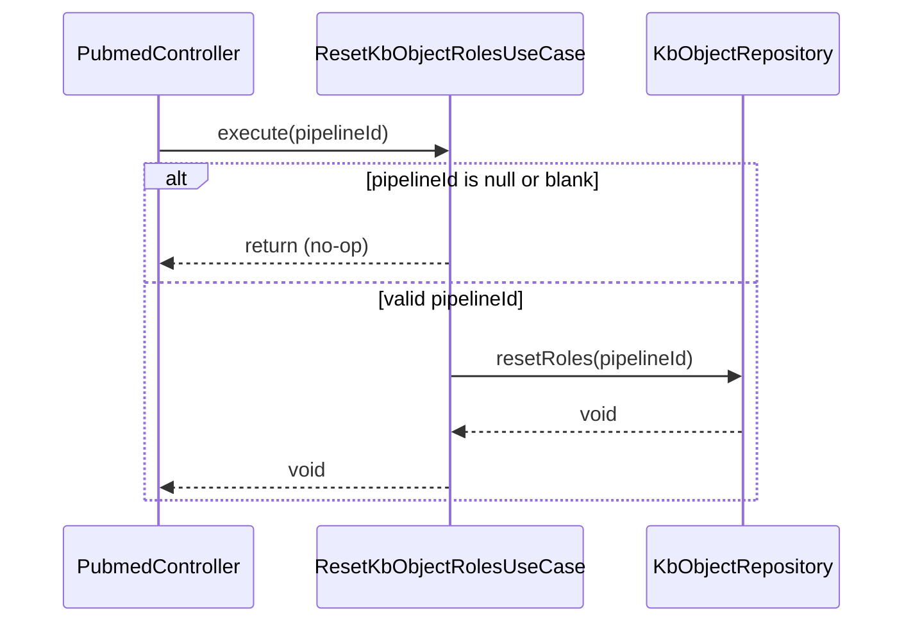

# ResetKbObjectRolesUseCase

## 1. Business Problem and Purpose
When biological role classification rules or ontology categorizations are re-evaluated for a pipeline, previously assigned roles stored on `kb_objects` must be cleared before recomputing them. This use case resets the `roles` field across all `kb_objects` belonging to a given `pipelineId`.

## 2. Contracts
- **Inbound Port:** `com.biopatternsg.domain.ports.in.ResetKbObjectRoles`
  - `void execute(String pipelineId)`
- **Outbound Ports:**
  - `com.biopatternsg.domain.ports.out.repositories.KbObjectRepository`
    - `void resetRoles(String pipelineId)`
- **Application Services:** None.
- **Delivery Adapter:** `PubmedController#resetKbObjectRoles` (`DELETE /pubmed/kb-objects/{pipelineId}/roles`, returns `200 OK`).

## 3. Execution Flow
1. Log the reset request with `LogSanitizer.sanitize(pipelineId)`.
2. Guard against invalid input: if `pipelineId` is `null` or blank, return early as a no-op.
3. Invoke `kbObjectRepository.resetRoles(pipelineId)` to clear roles on all matching documents in `kb_objects`.

## 4. Sequence Diagram

## 5. Exceptions, Caching, and Failure Scenarios
- **Input Guard (No-Op):** Null or blank `pipelineId` exits immediately without modifying MongoDB.
- **Idempotency:** Executing the reset multiple times on the same pipeline safely leaves all object roles cleared.
- **Log Sanitization:** `pipelineId` is sanitized with `LogSanitizer.sanitize(...)`.
