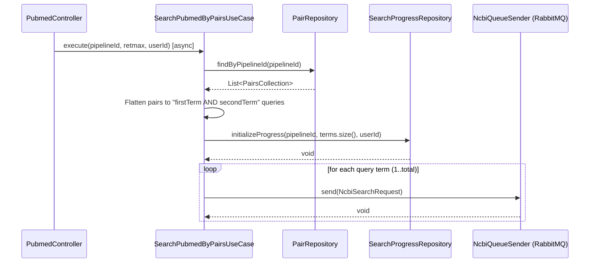

# SearchPubmedByPairsUseCase

## 1. Business Problem and Purpose
Once term pairs are generated for a pipeline, each pair must be queried against the NCBI PubMed ESearch API to discover relevant PubMed IDs (PMIDs) while respecting NCBI rate limits. This use case loads all pairs for a pipeline, initializes atomic progress tracking in MongoDB (`search_progress`), and enqueues each boolean query (`firstTerm AND secondTerm`) onto RabbitMQ (`ncbi-out`) for asynchronous processing by `NcbiRabbitConsumer`.

## 2. Contracts
- **Inbound Port:** `com.biopatternsg.domain.ports.in.SearchPubmedByPairs`
  - `void execute(String pipelineId, int retmax, String userId)`
- **Outbound Ports:**
  - `com.biopatternsg.domain.ports.out.repositories.PairRepository`
    - `List<PairsCollection> findByPipelineId(String pipelineId)`
  - `com.biopatternsg.domain.ports.out.repositories.SearchProgressRepository`
    - `void initializeProgress(String pipelineId, int totalCount, String userId)`
  - `com.biopatternsg.domain.ports.out.producers.NcbiQueueSender`
    - `void send(NcbiSearchRequest request)`
- **Application Services:** None.
- **Delivery Adapter:** `PubmedController#searchPairs` (`POST /pubmed/search-pubmed-ids-by-pairs`, executed asynchronously via `CompletableFuture.runAsync(...)` with `202 Accepted`; captures `userId` from `SessionUtils`).

## 3. Execution Flow
1. Load all `PairsCollection` documents for `pipelineId` via `pairRepository.findByPipelineId(pipelineId)`.
2. Flatten non-null `PairsCollection.Pair` entries across all documents and format each pair into a PubMed boolean query string: `firstTerm + " AND " + secondTerm`.
3. Initialize progress tracking in `search_progress` via `searchProgressRepository.initializeProgress(pipelineId, terms.size(), userId)`.
4. Iterate over all query terms (`i = 0..terms.size()-1`) and dispatch an `NcbiSearchRequest(pipelineId, term, retmax, i + 1, terms.size(), userId)` to RabbitMQ via `ncbiQueueSender.send(...)`.
5. Downstream, `NcbiRabbitConsumer` (`@Incoming("ncbi-in")`) consumes each request, queries NCBI ESearch with rate limiting, stores PMIDs in `pubmed_results`, increments `search_progress`, and upon completion of all terms deletes `pairs` and `search_progress` and updates `PipelineSteps.SEARCH_PUBMED_IDS` to `COMPLETED` in `config-and-control`.

## 4. Sequence Diagram

## 5. Exceptions, Caching, and Failure Scenarios
- **Per-Message Fault Isolation:** Exceptions thrown while enqueuing an individual term are caught and logged inside the dispatch loop so remaining terms continue to be enqueued.
- **Backpressure:** `NcbiQueueSenderRabbitAdapter` uses `@OnOverflow(OnOverflow.Strategy.UNBOUNDED_BUFFER)` on the `ncbi-out` emitter to avoid dropping messages during large fan-outs.
- **Empty Pairs Edge Case:** If no pairs exist for `pipelineId`, `initializeProgress` is called with `0` and no RabbitMQ messages are emitted.
- **Request Validation:** `SearchPairsByPipelineRequest` is validated with `@Valid` at `PubmedController`.
