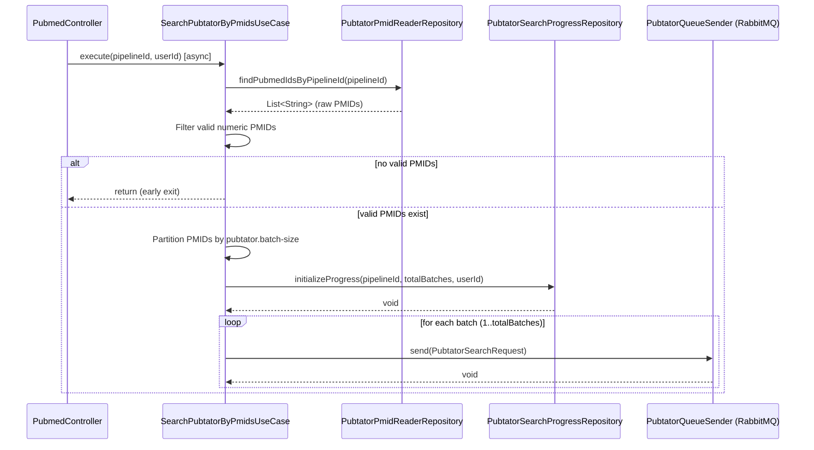

# SearchPubtatorByPmidsUseCase

## 1. Business Problem and Purpose
After PubMed IDs have been collected for a pipeline, each publication must be enriched with biomedical entity annotations and biological relations from the PubTator3 API. To optimize throughput and respect external API limits, this use case reads all valid numeric PMIDs for a pipeline, partitions them into fixed-size batches (`pubtator.batch-size`), initializes batch progress tracking in MongoDB (`pubtator_search_progress`), and enqueues each batch onto RabbitMQ (`pubtator-out`) for asynchronous consumption by `PubtatorRabbitConsumer`.

## 2. Contracts
- **Inbound Port:** `com.biopatternsg.domain.ports.in.SearchPubtatorByPmids`
  - `void execute(String pipelineId, String userId)`
- **Outbound Ports:**
  - `com.biopatternsg.domain.ports.out.repositories.PubtatorPmidReaderRepository`
    - `List<String> findPubmedIdsByPipelineId(String pipelineId)`
  - `com.biopatternsg.domain.ports.out.repositories.PubtatorSearchProgressRepository`
    - `void initializeProgress(String pipelineId, int totalCount, String userId)`
  - `com.biopatternsg.domain.ports.out.producers.PubtatorQueueSender`
    - `void send(PubtatorSearchRequest request)`
- **Application Services:** None.
- **Configuration Properties:**
  - `pubtator.batch-size` (default `50`): Maximum number of PMIDs per RabbitMQ batch message.
- **Delivery Adapter:** `PubmedController#searchPubtatorByPmids` (`POST /pubmed/search-pubtator-by-pmids`, executed asynchronously via `CompletableFuture.runAsync(...)` with `202 Accepted`; captures `userId` from `SessionUtils`).

## 3. Execution Flow
1. Fetch all PMIDs associated with `pipelineId` from `pubmed_results` via `pubtatorPmidReaderRepository.findPubmedIdsByPipelineId(pipelineId)`.
2. Filter the list to keep only non-null strings matching `\\d+` after trimming.
3. If no valid numeric PMIDs remain, log a warning and return early without initializing progress or enqueuing messages.
4. Partition the valid PMID list into sublists of at most `batchSize` elements (`totalBatches`).
5. Initialize progress tracking via `pubtatorSearchProgressRepository.initializeProgress(pipelineId, totalBatches, userId)`.
6. For each batch (`i = 0..totalBatches-1`), dispatch a `PubtatorSearchRequest(pipelineId, batch, i + 1, totalBatches, userId)` to RabbitMQ via `pubtatorQueueSender.send(...)`.
7. Downstream, `PubtatorRabbitConsumer` (`@Incoming("pubtator-in")`) skips PMIDs already cached in `pubtator_results`, queries PubTator3 for uncached PMIDs, persists documents containing events, and upon completing all batches updates `PipelineSteps.SEARCH_PUBTATOR` to `COMPLETED` in `config-and-control`.

## 4. Sequence Diagram

## 5. Exceptions, Caching, and Failure Scenarios
- **Input Sanitization:** Non-numeric or null PMID values are filtered out before batching so malformed entries never reach PubTator3.
- **Empty PMID Guard:** When no valid numeric PMIDs exist for `pipelineId`, the use case returns early without publishing messages.
- **Per-Batch Fault Isolation:** Exceptions thrown while enqueuing an individual batch are caught and logged so subsequent batches still proceed.
- **Global PMID Caching:** Caching occurs downstream in `PubtatorRabbitConsumer` against `pubtator_results` so previously fetched publications are never re-queried from PubTator3.
