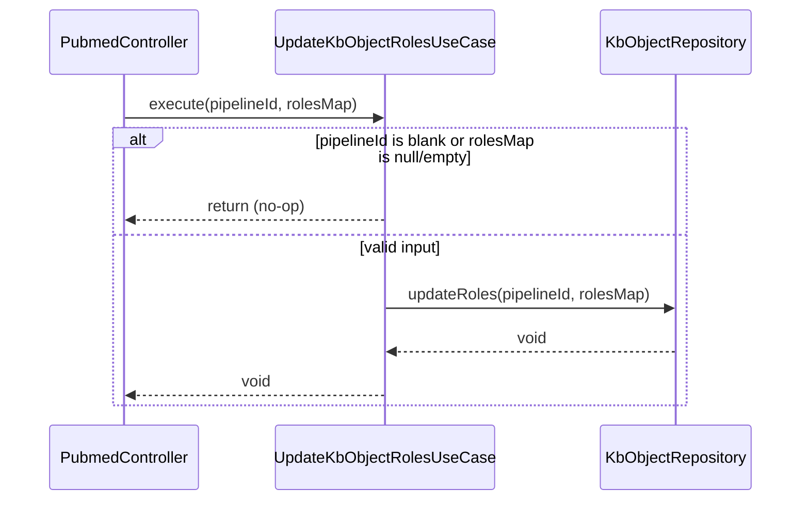

# UpdateKbObjectRolesUseCase

## 1. Business Problem and Purpose
Once biological roles (e.g., receptor, ligand, enzyme, transcription factor) have been classified for a pipeline's Knowledge Base objects, those roles must be persisted on the corresponding documents in `kb_objects`. This use case applies a bulk role update mapping object names to their assigned list of roles for a specific pipeline.

## 2. Contracts
- **Inbound Port:** `com.biopatternsg.domain.ports.in.UpdateKbObjectRoles`
  - `void execute(String pipelineId, Map<String, List<String>> rolesMap)`
- **Outbound Ports:**
  - `com.biopatternsg.domain.ports.out.repositories.KbObjectRepository`
    - `void updateRoles(String pipelineId, Map<String, List<String>> roles)`
- **Application Services:** None.
- **Delivery Adapter:** `PubmedController#updateKbObjectRoles` (`PATCH /pubmed/kb-objects/{pipelineId}/roles`, returns `200 OK`).

## 3. Execution Flow
1. Log the request with `LogSanitizer.sanitize(pipelineId)` and the entry count of `rolesMap`.
2. Validate preconditions: if `pipelineId` is `null` or blank, or if `rolesMap` is `null` or empty, return early as a no-op.
3. Delegate the bulk persistence update to `kbObjectRepository.updateRoles(pipelineId, rolesMap)`.

## 4. Sequence Diagram

## 5. Exceptions, Caching, and Failure Scenarios
- **Input Guard (No-Op):** Blank `pipelineId` or null/empty `rolesMap` returns immediately without issuing MongoDB write operations.
- **Idempotency:** Applying the same `rolesMap` repeatedly results in the same persisted role assignments per `kb_object`.
- **Log Sanitization:** `pipelineId` is sanitized with `LogSanitizer.sanitize(...)`.
